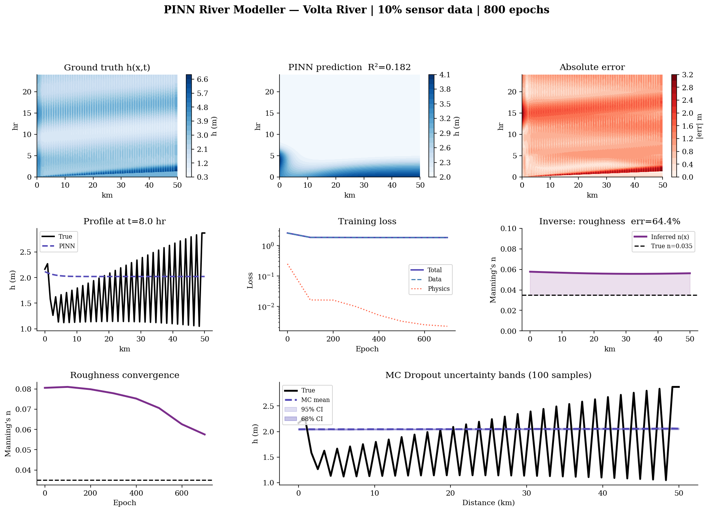

# PINN Multi-Physics Explorer

A modular framework for **physics-informed neural networks (PINNs)** that recovers physical fields from sparse sensor data. One shared training engine handles several different PDE systems: open-channel river flow (Saint-Venant), heat diffusion, wave propagation, orbital mechanics, and beam bending. Includes a dam/reservoir model, uncertainty estimates, and an interactive web app.

Built solo as an independent project; the paper was reviewed by a mentor.

**[Live demo](https://huggingface.co/spaces/trixx4191/pinn-explorer)** · **[Paper (PDF)](paper/pinn_multiphysics_paper.pdf)** · **[3D orbit demo](https://trixx4191.github.io/Physics-informed-ML-model-for-local-systems/threejs_orbit/orbit_scene.html)**



## Results

| Domain | Result |
|---|---|
| Orbital mechanics | Reconstructs a full elliptical orbit from 18% of the trajectory (R² = 0.87 on x) |
| Beam elasticity | Recovers the full deflection curve from 15% of sensors (R² = 0.9998) |
| Heat, wave | Verified against closed-form analytical solutions |
| Saint-Venant (rivers) | Works for depth; the stiff momentum equation remains hard (see Limitations) |

A sparsity benchmark compares each PINN with a same-size plain MLP at 5% to 100% of the data, so the physics prior is measured rather than assumed.

## Limitations

The coupled Saint-Venant momentum equation does not train as well as the other domains. The paper traces this to conflicting gradients between loss terms rather than to a lack of data, and discusses it openly.

## What's inside

- `core/` shared PINN engine, adaptive loss balancing (Wang et al., 2021)
- `domains/` fluids, dam, heat, wave, gravity, elasticity
- `models/` network architectures, Monte Carlo Dropout uncertainty
- `data/` Lax-Friedrichs Saint-Venant solver and sparse sampler
- `dash_app/` interactive web app
- `threejs_orbit/` standalone 3D orbit visualisation
- `paper/` full write-up
- `tests/` pytest suite, run in CI

## Run it

```bash
pip install -r requirements.txt
python dash_app/app.py          # http://localhost:8050
python run_experiment.py --domain heat --epochs 2000
pytest -q
```

More options in [RUNNING.md](RUNNING.md). Domains: `fluids`, `dam`, `heat`, `wave`, `gravity`, `elasticity`.

## Governing equations

**1D Saint-Venant (continuity + momentum):**
```
∂h/∂t + ∂(uh)/∂x = 0
∂(uh)/∂t + ∂(u²h + g·h²/2)/∂x + g·h·(Sf − S0) = 0
```
where friction slope `Sf = n²·u·|u| / h^(4/3)`

**Reservoir mass balance (dam module):**
```
A · dZ/dt = Q_in(t) - Q_out(Z)
Q_out = Cd · W · √g · Z^1.5   (broad-crested weir)
```

**Physics loss (PINN training):**
```
L = λ₁·MSE(data) + λ₂·MSE(PDE residuals at collocation points)
```

## References
- Raissi, M., Perdikaris, P., Lagaris, G.E. (2019). Physics-informed neural networks. *Journal of Computational Physics*, 378, 686–707.
- Shi et al. (2020). Saint-Venant equations for river flow.
- Cunge, J.A., Holly, F.M., Verwey, A. (1980). *Practical Aspects of Computational River Hydraulics*. Pitman.
